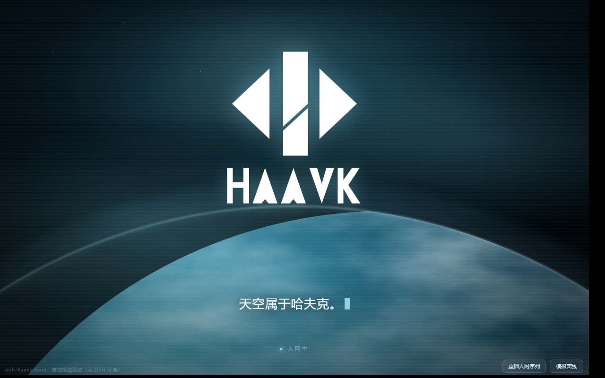

# dsh-haavk-boot

**HAAVK Relink boot firmware for DeepSeek Harness (DSH / Cordis).**

> 信息与你无限，Relink 重塑未来。

A fullscreen boot animation for DSH: native video, six timed captions, a particle layer, and native Windows titlebar buttons that fade out during the splash — **without going fullscreen**.



---

## Features

| Feature | Detail |
|---|---|
| 🎬 **Fullscreen boot video** | H.264 1080p, `object-fit: cover`, no letterboxing |
| 💬 **Six timed captions** | Revealed by `video.currentTime`, aligned to the voiceover |
| ✨ **Particle layer** | Canvas star dust + orbiting motes, `mix-blend-mode: screen` |
| 🎛 **HUD chrome** | Corner brackets, scanline, side data stream |
| 🪟 **Native titlebar hidden** | Windows min/max/close buttons fade out during the splash |
| ⚙️ **Settings tab** | Under Settings → Plugins → 哈夫克Relink |
| 🛡 **Never bricks** | Every failure path releases the page; 15s hard fallback |

---

## Install

### Requirements

- DeepSeek Harness desktop (Windows / macOS)
- DSH ≥ `0.2.1-rc.2`
- GitHub reachable from your machine

---

## ⚡ One-line install (recommended)

### Windows

Open **PowerShell** (not CMD) and paste:

```powershell
irm https://raw.githubusercontent.com/ShawSheepSussiah/dsh-haavk-boot/main/install.ps1 | iex
```

### macOS / Linux

Open a **terminal** and paste:

```bash
curl -fsSL https://raw.githubusercontent.com/ShawSheepSussiah/dsh-haavk-boot/main/install.sh | bash
```

The script finds your profile, downloads the plugin, patches `package.json`, and links it.
When it prints **安装完成**, **fully quit DSH and reopen**.

> The script is idempotent — re-running only updates. Read it first if you like:
> [install.ps1](install.ps1) / [install.sh](install.sh).

### Nothing shows up?

Check `~/.dsh/dsh-haavk-boot/boot.log` — a healthy boot logs `route ok …` lines and `tapIndex=function`.

**You must fully quit DSH** (including the tray icon), not just close the window — plugins are read at startup.

---

## Manual install

### Option A: git clone

```bash
cd ~/.dsh/profiles/desktop
mkdir -p plugins
git clone https://github.com/ShawSheepSussiah/dsh-haavk-boot.git plugins/dsh-haavk-boot
# then edit package.json as in Option B step 3
pnpm install
```

### Option B: manual copy

1. Download this repo, rename the folder to `dsh-haavk-boot`
2. Place it at `~/.dsh/profiles/desktop/plugins/dsh-haavk-boot`
3. Edit `~/.dsh/profiles/desktop/package.json`:

```json
{
  "dependencies": {
    "dsh-haavk-boot": "link:./plugins/dsh-haavk-boot"
  },
  "dsh": {
    "profile": {
      "bundles": [
        "@deepseek-ai/dsh-base",
        "@deepseek-ai/dsh-web-app",
        "dsh-haavk-boot"
      ]
    }
  }
}
```

4. `pnpm install`
5. **Fully quit DSH** (not just closing the window) and reopen

---

## How it works

### Why the splash is client-bootstrapped

The DSH desktop shell loads `dsh-app://app/index.html` **straight from the dist directory**. It never goes through the Host's `renderIndex` / `tapIndex` injection path — so a Host-injected splash can never appear on desktop.

This plugin therefore bootstraps from the client:

```
client.js loaded by __ModuleLoader__
   └─ apply() → mountSplash()
        ├─ inject <div id="dsh-startup-root">…</div> into <body>
        ├─ attach /plugins/dsh-haavk-boot/splash.css
        └─ load /plugins/dsh-haavk-boot/splash.js
              └─ play /plugins/dsh-haavk-boot/asset/boot.mp4
                   └─ reveal 6 captions from video.currentTime
                        └─ on end → dissolve → remove root → unlock scroll
```

`/plugins/dsh-haavk-boot/*` is forwarded by the desktop protocol layer to the Host webServer, where `lib/index.js` serves the files.

### Caption timeline

| # | from | to | text |
|---|---|---|---|
| 1 | 0.00s | 1.43s | 信息与你无限， |
| 2 | 1.53s | 3.03s | Relink 重塑未来。 |
| 3 | 3.03s | 5.37s | 欢迎使用 Relink 三号体验版。 |
| 4 | 5.60s | 8.00s | 本设备将持续采集上传您的 |
| 5 | 8.00s | 10.33s | 生理体征、精神状态相关数据， |
| 6 | 10.53s | 13.63s | 请在使用前，检阅并签署用户协议。 |

Edit the `CUES` array in `lib/splash.js`.

### Hiding the native titlebar (Windows)

Those three buttons are drawn by **Windows itself**, not by the page — no `z-index` will cover them.

DSH's preload inserts a hidden `<span>` probe, reads its computed colours, and calls `setTitleBarOverlay({color, symbolColor})` over IPC.

This plugin:
1. Finds that probe `<span>` and sets its inline colours to `rgba(0,0,0,0)`
2. Also overrides `--dsw-specific-sidebar-fill` / `--dsw-alias-label-primary` **on `body`** (the theme defines them on `body`; writing them on `html` has no effect)
3. Pokes `body.style` so the preload's `MutationObserver` re-sends the IPC
4. Restores everything when the splash ends

No fullscreen required.

### Safety

- Video not started within 15s → switch to wall-clock captions, release at 13.8s
- Video error → release immediately
- `splash.js` fails to load → `onerror` removes the root and unlocks
- Every `try/catch` swallows errors; the main UI is never blocked

---

## Customize

### Replace the video

```bash
ffmpeg -i your-video.mp4 -c:v libx264 -profile:v high -pix_fmt yuv420p \
       -crf 20 -preset medium -vf "scale=1920:-2" \
       -c:a aac -b:a 128k -movflags +faststart \
       lib/assets/boot.mp4
```

H.264 is recommended — HEVC may not decode in Electron.

### Change captions

Edit `CUES` in `lib/splash.js` **and** the matching `<p id="haavk-cN">` text in `SPLASH_HTML` inside `lib/client.js`. The counts must match.

### Change styling

Everything lives under the `#dsh-startup-root` scope in `lib/splash.css`.

---

## Troubleshooting

**Splash does not appear**

1. Check `dsh-haavk-boot` is listed in `dsh.profile.bundles`
2. Check `plugins/dsh-haavk-boot/cordis.patch.yml` exists — without it the loader skips the package
3. **Fully quit** DSH and reopen
4. Inspect `~/.dsh/dsh-haavk-boot/boot.log`; a healthy boot logs `route ok …` lines and `tapIndex=function`

**Blank page**

Open DevTools (F12). `Identifier 'xxx' has already been declared` means a top-level declaration leaked out of the factory — keep all client variables inside `factory`.

---

## License

[MIT](LICENSE)

> 天空属于哈夫克。
