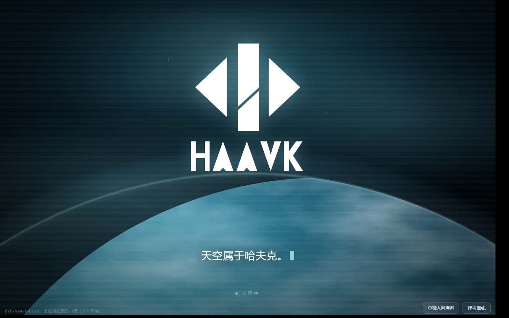

# dsh-haavk-boot

**哈夫克 Relink 节点启动固件** — DeepSeek Harness（DSH / Cordis）的开机动画插件。

> 信息与你无限，Relink 重塑未来。

一句话：**让 DSH 启动时先播一段原生开机动画，再进主界面。**



---

## 特性

| 特性 | 说明 |
|---|---|
| 🎬 **全屏开机视频** | H.264 1080p 原生渲染，`object-fit: cover` 满屏，不黑边 |
| 💬 **逐句字幕** | 6 条字幕按视频真实播放时间点亮，与配音严格对齐 |
| ✨ **粒子层** | Canvas 星尘 + 光尘，`mix-blend-mode: screen` 叠在视频上 |
| 🎛 **HUD 边框** | 四角光标、扫描线、右侧数据流，哈夫克风格 |
| 🪟 **标题栏隐身** | Windows 上隐藏原生最小化/最大化/关闭按钮，**不需要全屏** |
| ⚙️ **设置面板** | 挂在「设置 → 插件 → 哈夫克Relink」，可关动画、重播 |
| 🛡 **绝不锁死** | 任何一步失败都放行页面，视频 15s 兜底放行 |

---

## 安装

### 前置条件

- **DeepSeek Harness** 桌面版（Windows / macOS）
- DSH 版本 ≥ `0.2.1-rc.2`
- Node.js ≥ 22.19，pnpm（DSH 自带）

### 方式一：从源码安装（推荐）

```bash
# 1. 进入你的 DSH profile 目录
#    Windows: C:\Users\<你的用户名>\.dsh\profiles\desktop
#    macOS:   ~/.dsh/profiles/desktop
cd ~/.dsh/profiles/desktop

# 2. 把插件放进 plugins/ 子目录
mkdir -p plugins
git clone https://github.com/<你的用户名>/dsh-haavk-boot.git plugins/dsh-haavk-boot

# 3. 登记为依赖（在 package.json 的 dependencies 里加一行）
#    "dsh-haavk-boot": "link:./plugins/dsh-haavk-boot"

# 4. 加入 bundles 列表（在 package.json 的 dsh.profile.bundles 数组末尾加一项）
#    "dsh-haavk-boot"

# 5. 安装链接
pnpm install

# 6. 完全退出 DSH，重新打开
```

### 方式二：手动复制

1. 下载本仓库，把整个文件夹重命名为 `dsh-haavk-boot`
2. 放到 `~/.dsh/profiles/desktop/plugins/` 下
3. 编辑 `~/.dsh/profiles/desktop/package.json`：

```json
{
  "dependencies": {
    "dsh-haavk-boot": "link:./plugins/dsh-haavk-boot"
  },
  "dsh": {
    "profile": {
      "bundles": [
        "@deepseek-ai/dsh-base",
        "@deepseek-ai/dsh-web-app",
        "dsh-haavk-boot"
      ]
    }
  }
}
```

4. `pnpm install`
5. **完全退出 DSH**（不是关窗口，是退出进程），重新打开

---

## 目录结构

```
dsh-haavk-boot/
├── package.json           插件清单（含 dsh.bundle.patch 声明）
├── cordis.patch.yml       把插件插入 loader 树的 patch
├── lib/
│   ├── index.js           Host 端：注册路由 / 配置 / SSE / 遥测
│   ├── client.js          Web 端：自举启动屏 + 设置面板
│   ├── splash.js          启动屏运行时：视频 → 字幕 → 溶解
│   ├── splash.css         启动屏样式（全屏锁死 + HUD + 粒子层）
│   └── assets/
│       └── boot.mp4       开机视频（6.2 MB，H.264 1080p）
└── docs/screenshots/
```

---

## 工作原理（给想改的人）

### 启动屏怎么出现

DSH 桌面端的主页面是 `dsh-app://app/index.html`，**直接从 dist 目录读文件返回**，不经过 Host 的 `renderIndex` / `tapIndex` 注入流程。

所以本插件走的是**客户端自举**：

```
client.js 被 __ModuleLoader__ 加载
   └─ apply() → mountSplash()
        ├─ 往 <body> 插入 <div id="dsh-startup-root">…</div>
        ├─ 挂载 /plugins/dsh-haavk-boot/splash.css
        └─ 加载 /plugins/dsh-haavk-boot/splash.js
              └─ 播放 /plugins/dsh-haavk-boot/asset/boot.mp4
                   └─ 按 video.currentTime 点亮 6 条字幕
                        └─ 视频结束 → 溶解 → 移除 root → 解锁滚动
```

`/plugins/dsh-haavk-boot/*` 这些路径会被桌面协议层转发给 Host 的 webServer，由 `lib/index.js` 注册的路由提供文件。

### 字幕时间轴

| # | 起 | 止 | 文字 |
|---|---|---|---|
| 1 | 0.00s | 1.43s | 信息与你无限， |
| 2 | 1.53s | 3.03s | Relink 重塑未来。 |
| 3 | 3.03s | 5.37s | 欢迎使用 Relink 三号体验版。 |
| 4 | 5.60s | 8.00s | 本设备将持续采集上传您的 |
| 5 | 8.00s | 10.33s | 生理体征、精神状态相关数据， |
| 6 | 10.53s | 13.63s | 请在使用前，检阅并签署用户协议。 |

由 `splash.js` 里的 `CUES` 数组控制，改时间轴直接改这个数组。

### 标题栏按钮怎么隐藏（Windows）

那三个按钮是 **Windows 原生绘制**的，不是网页元素，`z-index` 再高压不住。

DSH 的 preload 里有一段逻辑：往 `<body>` 塞一个隐藏 `<span>` 探针，读它的计算色，通过 IPC 调 `setTitleBarOverlay({color, symbolColor})`。

本插件做的：
1. 找到那个探针 `<span>`，把它的内联色改成 `rgba(0,0,0,0)`
2. 同时在 `body` 上覆盖 `--dsw-specific-sidebar-fill` / `--dsw-alias-label-primary`（这两个变量定义在 `body` 上，写 `html` 无效）
3. poke 一次 `body.style`，触发 preload 的 `MutationObserver` 重发 IPC
4. 启动屏结束 → 恢复原值

**不需要全屏**，窗口模式下也能隐身。

### 安全兜底

- 视频 15s 内没开始播 → 切墙钟驱动字幕，13.8s 后放行
- 视频加载失败 → 直接放行
- `splash.js` 加载失败 → `client.js` 的 `onerror` 移除 root 并解锁
- 任何 `try/catch` 都吞掉异常，绝不阻塞 DSH 主界面

---

## 自定义

### 换视频

```bash
# 建议先转成 H.264（HEVC 在 Electron 里可能不播）
ffmpeg -i 你的视频.mp4 -c:v libx264 -profile:v high -pix_fmt yuv420p \
       -crf 20 -preset medium -vf "scale=1920:-2" \
       -c:a aac -b:a 128k -movflags +faststart \
       lib/assets/boot.mp4
```

### 改字幕

编辑 `lib/splash.js` 里的 `CUES`，同时改 `lib/client.js` 里 `SPLASH_HTML` 的 `<p id="haavk-cN">` 文案。两边必须条数一致。

### 改外观

`lib/splash.css` 里全部是 `#dsh-startup-root` 作用域下的样式，字体、颜色、位置都在那。

---

## 设置面板

装好后打开 **设置 → 插件 → 哈夫克Relink**，可以：

- 启用 / 关闭节点
- 开关开机启动屏
- 开关「热重载后重播」
- 一键重播启动屏

改动会写入 `~/.dsh/dsh-haavk-boot/settings.json`。

---

## 排错

**启动屏不出现？**

1. 确认 `~/.dsh/profiles/desktop/package.json` 的 `bundles` 里有 `dsh-haavk-boot`
2. 确认 `plugins/dsh-haavk-boot/cordis.patch.yml` 存在（缺这个 loader 不会加载）
3. **完全退出 DSH 再打开**（关窗口不算）
4. 看 `~/.dsh/dsh-haavk-boot/boot.log`，正常应该有：
   ```
   apply()  v=0.2.0  webServer=yes
   route ok /plugins/dsh-haavk-boot/splash.css
   ...
   tapIndex=function
   ```

**页面白屏打不开？**

按 F12 看 Console。如果是 `Identifier 'xxx' has already been declared`，说明 `client.js` 顶层有变量声明——本插件所有变量都在 `factory` 内，不应出现；若你改过代码，把变量包回 `factory` 里。

**字幕和声音对不上？**

`CUES` 的时间是按视频音轨转写出来的。换视频后要重新对齐。

---

## 兼容性

- ✅ Windows 10/11 桌面版（标题栏隐身仅 Windows 生效）
- ✅ macOS（无标题栏按钮，其余功能正常）
- ⚠️ Web 版：启动屏会正常显示，但 `/` 页面需要登录态，`client.js` 加载时机可能略晚

---

## 许可

[MIT](LICENSE)

## 致谢

- 视觉风格来自《三角洲行动》哈夫克 Relink 开机仪式
- 插件架构参考 dsh-dafeiyu 的 slots 注册写法

---

> 天空属于哈夫克。
